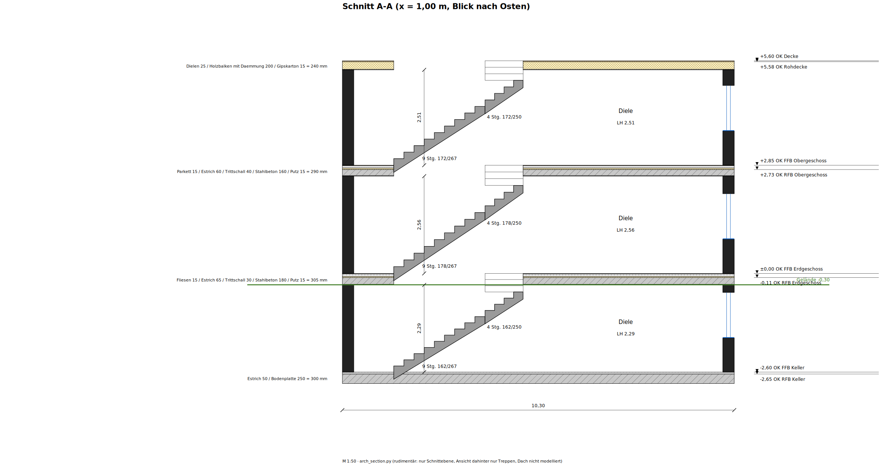

# archlang-section

Rudimentary building sections (Schnitte) for [ArchLang](https://github.com/ChanMeng666/archlang) floor plans.

ArchLang 1.55 draws floor plans only — heights are a datum that "draws nothing", and sections/elevations
are planned upstream for a later `archlang3d` package. Until then this tool reads what ArchLang itself
exports (Plan JSON per storey and `describe --json`) and draws a vertical section along an axis-aligned
cut line as **SVG, PNG and DXF**. The ArchLang package is not modified.



`example/haus.arch` is a real three-storey plan (Keller/EG/OG, identical floor plan) whose slab build-ups are not measured yet, so its sections show the red TODO slabs.

## Install

```sh
git clone https://github.com/gerontec/archlang-section && cd archlang-section
npm install                      # ArchLang (@chanmeng666/archlang)
pip install --user ezdxf cairosvg
```

## Use

```sh
./arch_section.py example/haus.arch            # all @section lines
./arch_section.py plan.arch --section A -o out/ --scale 50 --no-dxf
# demo.arch and haus_winders.arch use `landing … winders <n>` (ArchLang branch feat/stair-winders):
ARCHLANG_CLI=/path/to/archlang/dist/cli.js ./arch_section.py example/demo.arch
```

Output: `<plan>_schnitt_<name>.svg|png|dxf` next to the plan (or in `-o`). The SVG is to scale (default 1:50).
Set `ARCHLANG_DIR` to use an ArchLang install in another directory.

## Directives

Section data lives in **comments** of the `.arch` file, so ArchLang still compiles it unchanged:

| Directive | Meaning |
|---|---|
| `# @section A x=4300 look east` | cut along x = 4300 mm, looking east (`x=` needs east/west, `y=` north/south) |
| `# @floor 0 Fliesen:15 Estrich:65 Trittschall:30 Stahlbeton:180 Putz:15` | floor build-up **on** level 0, top → bottom, mm; quote names with spaces: `"Holzbalken mit Daemmung":200` |
| `# @floor -1 …` / `# @floor <top+1> …` | lowest level = ground slab; one above the top storey = top ceiling |
| `# @ground -300` | terrain line, mm relative to the datum |
| `# @datum 0` | level whose finished floor is ±0,00 (default 0) |
| `# @stairwell closed` | keep the slab above a cut stair (default: open) |

A level without `@floor` gets an assumed 250 mm slab, drawn red and marked TODO.

## What it draws

* walls cut by the line, thickness from `walls from rooms` (exterior / partition / `between … thickness`)
* doors as gaps with lintel, windows with sill, head and glazing (`sill` / `head` from the plan)
* slabs layer by layer, hatched by material keyword (Beton, Estrich, Dämmung, Holz, Putz, …)
* level marks OK FFB (finished floor) and OK RFB (top of the first structural layer), ±0,00 at the datum
* clear height (LH) per room, overall dimension, terrain line
* straight and turning stairs (`stair { flight … landing … flight … }`): each flight along the cut with
  risers/goings (`16 Stg. 175/225`), across the cut as a flight slab; landings flat. The storey rise is
  shared by step count (equal risers): a flight's goings as ArchLang draws its treads, a level landing none,
  one riser before every going and the arrival riser onto the floor above (n goings, n + 1 risers).
  A stair the cut passes through is drawn whole: the pieces behind the cut plane in view (thin lines,
  a flight seen end-on as its nosings), the pieces in front of it left out.
  Winders (`landing … winders <n>`) rise with their own steps; that clause needs the ArchLang branch
  `feat/stair-winders` (see `example/haus_winders.arch`, `example/poc_winders.png`). Run against a local
  build with `ARCHLANG_CLI=/path/to/archlang/dist/cli.js`

Storey height (finished floor to finished floor) comes from ArchLang's `level … height`; clear height is
storey height minus the `@floor` build-up of the level above.

## Limits

Only what the cut plane hits — nothing behind it is projected except the cut stair, no roofs, axis-aligned cuts only,
no winders (see above), rooms/walls from `walls from rooms` (authored `wall` statements are not read),
and the cut line is not drawn in the floor plan (ArchLang has no element for it).

## License

MIT, see [LICENSE](LICENSE). ArchLang itself is a separate project under its own license.
